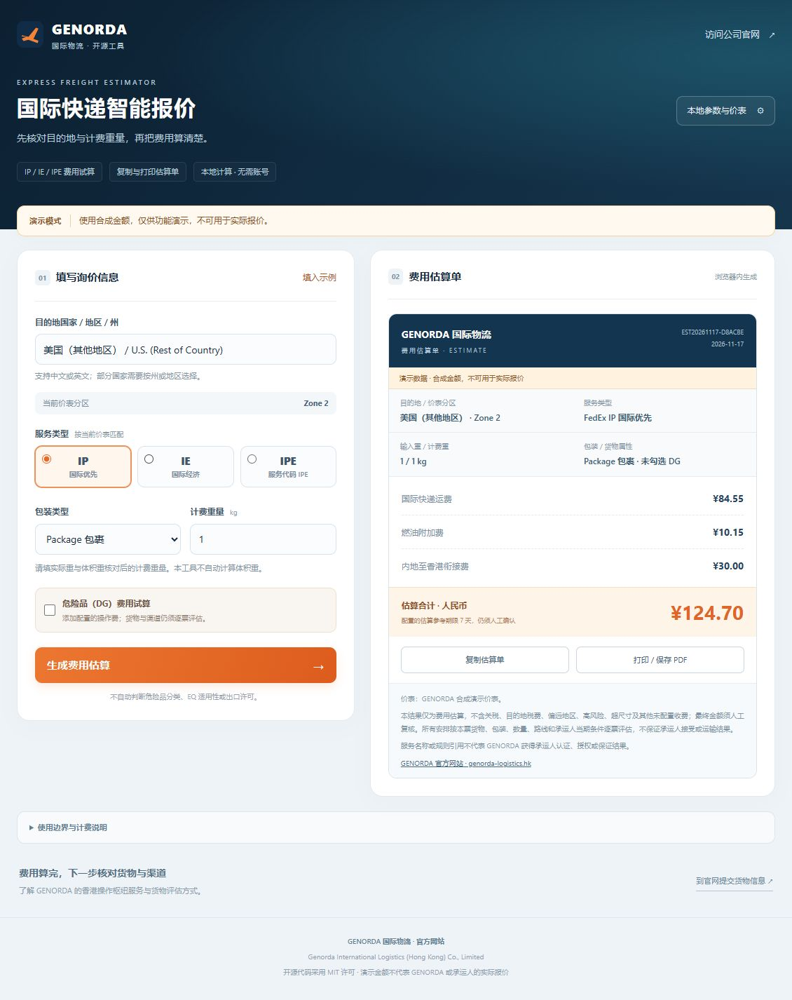

# GENORDA 国际快递报价工具

一个可自行部署的静态报价小工具：按目的地、服务、包装和计费重量查价，组合附加费，生成可复制、打印或保存为 PDF 的参考报价单。

由 [GENORDA 国际物流](https://www.genorda-logistics.hk/) 整理。香港主体为 **Genorda International Logistics (Hong Kong) Co., Limited**。GENORDA 以香港为操作枢纽，面向中国企业评估化学品与危险品出口安排，先判断货物，再匹配适用渠道。

**开源版本内置的是合成演示价格，不是 GENORDA 或任何承运人的实际报价。** 分区和服务可用性也是示例数据，不代表实时承运条件。原始实际运价不包含在本仓库或公开发布包内。



## 功能

- 中文、繁体中文和英文目的地匹配，保留 239 条目的地示例记录；其中包含地区及州级条目，不能理解为 239 个国家。
- IP、IE、IPE 服务及 Package、Pak、Envelope 包装选择，按价表处理可用组合。
- 按重量档和大货每公斤价计算基础运费，支持燃油、危险品操作费、过港费和加价参数。
- 生成参考报价单，复制文本、打印或通过浏览器保存为 PDF。
- 在浏览器中导入自己的 JSON 运价表；导入文件在本地处理，不上传。
- 提供 GENORDA 官网入口，便于进一步提交货物信息评估。

纯 HTML、CSS、JavaScript，无后端，无第三方运行依赖。报价计算不调用承运人 API，也不向服务器提交询价信息；主动点击官网链接时，浏览器会访问相应网站。

## 本地运行

安装 [Node.js](https://nodejs.org/) 20 或更高版本后，在项目目录运行：

```sh
npm start
```

打开终端显示的本地地址，默认是：

```text
http://127.0.0.1:4173
```

无需先运行 `npm install`。辅助脚本只使用 Node.js 内置模块。

```sh
npm test       # 检查计费及数据处理逻辑
npm run build  # 生成静态发布目录 dist/
```

## 在 GitHub 上使用

1. 将本项目文件上传或推送到自己的 GitHub 仓库，保留 `.github/workflows/` 等隐藏目录。
2. 在仓库 **Settings → Pages → Build and deployment** 中，将来源设为 **GitHub Actions**。
3. 推送到 `main` 后，或手动运行仓库中的 Pages 工作流，等待构建和部署完成。
4. 以 GitHub 实际返回的 Pages 地址为准。本说明不表示仓库或演示站已上线。

工作流按 [GitHub Pages 官方说明](https://docs.github.com/en/pages/getting-started-with-github-pages/using-custom-workflows-with-github-pages) 配置；只上传 `dist/` 中的公开静态文件。

静态资源采用相对路径，可部署到 GitHub Pages 的项目子目录。也可以把 `npm run build` 生成的 `dist/` 部署到其他静态托管服务。

## 使用自己的运价表

### 浏览器导入

在工具的参数设置区域选择 JSON 运价文件。数据格式见 [运价格式说明](docs/data-format.md)。

导入的运价仅保留在当前页面的内存中，刷新页面后需要重新导入。公司抬头、燃油和其他业务参数保存在当前浏览器的 `localStorage` 中，不会随仓库提交或自动同步到别的设备。

### 转换原始 `rates.js`

如果手头是旧工具使用的 `const RATES = …; const ZONE_MAP = …;` 文件，可在本地转换：

```sh
node scripts/convert-rates.mjs "path/to/rates.js"
```

脚本使用 JSON 解析提取原始数据，不执行输入文件里的 JavaScript。默认结果写入：

```text
.private/rates.private.json
```

再通过浏览器导入该文件。`.private/` 已被 Git 忽略，构建脚本也不将其复制到 `dist/`。转换前应确认自己有权使用这份运价。

**前端页面无法保密其加载的运价或加价逻辑。** 参数抽屉不是权限管理。若把实际运价放进公开静态资源、提交到 GitHub 或打进公开下载包，访问者就能获取它们。需要账号权限、服务器查价或合同价保密时，应另行实现后端访问控制。

## 计算口径与边界

本工具沿用以下费用组合模型：

```text
基础费用 = 运费 + 危险品操作费（如勾选）
燃油费   = 基础费用 × 燃油费率
过港费   = max(最低过港费, 计费重量 × 每公斤过港费)
参考合计 = 各费用行乘以 (1 + 加价率)、分别四舍五入到分后的金额之和
```

免燃油分区必须在数据规则中明确配置；演示版默认没有免燃油分区。演示规则将小件重量按 0.5 kg 进位，大货按 1 kg 进位；文件封上限 0.5 kg、快递袋上限 2.5 kg。上述是工具的示例计算规则，可随经确认的价表调整，不能作为承运人的通用承诺。

危险品试算仅支持 Package 包装。勾选危险品和算出金额不构成收货、渠道或合规批准。本工具不根据包装净重自动认定 EQ，也不输出“小包装必然适用某个优惠危险品费”的结论。

报价是否可执行，须按本票货物、包装、数量、路线和承运人当期条件逐票评估。危险品分类、文件、包装、出口、跨境陆运及目的地进口义务均需另行核对。规则引用不代表 GENORDA 获得认证或保证运输结果。

本工具不是 FedEx 或其他承运人的官方产品；服务名称用于识别价表字段，不表示获得其授权、背书或保证接受。偏远、超尺寸、高风险、税费等费用是否适用，应以实际合同与本票核对结果为准。

## 项目结构

```text
index.html                  页面结构
assets/                     样式、交互和独立计费引擎
data/demo-rates.js           合成演示运价和目的地示例
scripts/                    本地服务器、构建和旧价表转换
test/                       计费及数据处理检查
.github/workflows/          GitHub Pages 发布工作流
docs/data-format.md         JSON 运价格式
.private/                   本地私有数据；不提交、不发布
dist/                       构建产物；不提交源码仓库
```

## 许可与反馈

代码及随附合成演示数据采用 [MIT License](LICENSE)。GENORDA 名称、标识及第三方商标的使用权不随代码许可授予。实际业务运价和其他未随仓库公开的资料不在许可范围内。

改进方式见 [贡献说明](CONTRIBUTING.md)。反馈问题时请使用演示数据复现，不要在公开 Issue 中提交真实合同价、客户信息、凭证或密钥。

## English summary

GENORDA Express Quote is a dependency-free, browser-based reference quotation tool. It supports destination lookup, service and packaging selection, weight-based freight, configurable surcharges, copyable quotations, and printing. Visit [GENORDA International Logistics](https://www.genorda-logistics.hk/) for shipment assessment.

The public project contains **synthetic demo prices only**. Its 239 destination records include regions and state-level entries; they do not represent 239 countries or current service acceptance. Private JSON rate files are processed locally and remain in page memory. Static frontends cannot hide rate tables or pricing logic from their visitors.

Run with Node.js 20+: `npm start`; check with `npm test`; build with `npm run build`. Deploy `dist/` using the included GitHub Pages workflow or another static host. Code and synthetic demo data are MIT-licensed; trademark rights and private commercial rate data are excluded.

All arrangements require shipment-specific assessment of the goods, packaging, quantity, route, and current carrier conditions. A calculated price does not constitute carrier acceptance, certification, or a guarantee of shipment outcome.
